# 滇界云管 V4 · 产品功能架构

> 整理依据：`README.md`、`TEAM_HANDOFF_2026-07-17.md`、`docs/releases/1.3.1~1.3.3.md`、
> `packages/db/prisma/schema.prisma`、`apps/api/src/routes/*`、`apps/web/src/app/v2/*`、
> 各角色 shell 导航配置与 `apps/api/src/lib/auth-scope.ts`。
> 本文是**代码与版本记录反推的功能架构**，不扩写未上线的需求。

## 1. 一句话定位

滇界 V4 是南京云洱之境餐饮集团自用的**多角色连锁餐饮经营管理系统**。
核心不是单一“进销存”，而是把「订货 → 配送 → 收货 → 库存 → 营业/BOM → 对账/付款/发票/资金/凭证」串成**可审计的业务闭环**，并为老板、财务、店长、厨师长、总厨、供应商、内部供应链、工程部提供各自工作台。

当前版本 **1.3.3**（2026-10-28）；正式 `https://dianjie.cc/v2/login`，测试 `https://www.dianjie.cc:8085/v2/login`，两环境库/会话/签名隔离。

---

## 2. 产品功能架构图（总览）

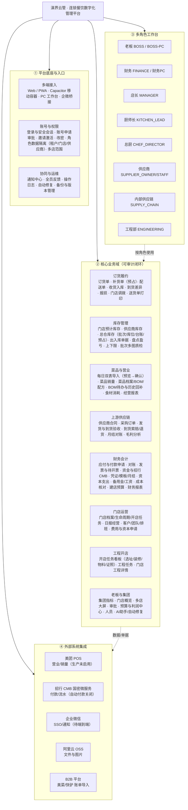

---

## 3. 核心业务闭环图

---

## 4. 功能域清单

### 4.1 订货履约域
| 功能 | 说明 | 主要入口 |
|---|---|---|
| 门店订货单 | 原始订购量不可无痕覆盖；修订需门店确认；编号、并发、幂等 | `/v2/manager/purchase`、`/v2/chef/purchase`、`/v2/chef-director/orders` |
| 独立补货单 | 提交后预占库存，撤回/取消释放，接单不重复占用 | `/v2/manager/replenishment-orders`、`/v2/supply-chain/replenishment-orders` |
| 配送单 | 一订单多配送；发货前调整实发量；`SHIPPED→DELIVERED→RECEIVED` | `/v2/supply-chain/deliveries`、`/v2/supply-chain/fulfillment` |
| 收货/入库 | 原子收货、短量报损、分批收货保留尾差 | `/v2/manager/purchase/[id]/receive`、`/v2/supply-chain/receipts` |
| 到货差异与报损 | 短缺/破损责任确认；报损争议仲裁 | `/v2/supply-chain/differences`、`/v2/chef-director/loss`、`/v2/loss-claims` |
| 门店调拨 | 按实发、实收、完好退回、损坏登记数量与成本 | `/v2/supply-chain/transfers` |
| 送货单打印 | 竖版表格、库位/分类排序、合并单号自动换行 | `delivery-note-paper.tsx`、`*/delivery-note` |

### 4.2 库存域
| 功能 | 说明 |
|---|---|
| 门店预计库存 | 最近盘点 + 确认收货 − BOM/人工/日报消耗 − 店内报损（页面统一带“预计”字样） |
| 供应商库存 | 独立流水账，与门店库存分账，不互相改写 |
| 总仓/仓库库存 | 批次、库位、台账流水、预占与分配 |
| 出入库单据 | 入库/出库/自损统一管理，审核后生效 |
| 盘点管理 | 多人盘点、盈亏单、总仓盘点 |
| 库存上下限 | 库存策略与修订记录、补货规则 |
| 库存报表 | 库存查询、管理与验收报表 |
| 批次质检 | 按商品进货批次维护多张图片、未保存关闭保护 |

### 4.3 菜品与营业域
| 功能 | 说明 |
|---|---|
| 每日双表导入 | 综合营业统计 + 菜品销售明细，先预览后确认，单事务原子写入 |
| 菜品销量 | `DishSale`，按日/菜品统计 |
| 菜品档案与 BOM | 规格配方、版本、损耗、排除策略（如“百家蘸料”不扣库存） |
| BOM 待办与回补 | 缺菜品/BOM 转 `DeferredBomTask`，总厨补档后幂等回补历史消耗 |
| 食材消耗 | `StockConsumption`，按 BOM 毛重口径计算 |
| 经营报表 | 营业额/收入/订单/优惠及时间对比 |

### 4.4 上游供应链域
供应商合同与合同行 → 采购订单（含修订/事件）→ 发货/到货验收（多图质检）→ 到货索赔/退货 → 月结对账单与发票分摊；配套上游供应商档案、资质证据、商品来源。

### 4.5 财务会计域
| 分组 | 功能 |
|---|---|
| 应付 | 应付管理、上游采购对账、付款申请、付款规则 |
| 发票 | 发票审核、待开票跟踪 |
| 资金 | 资金台账、现金/银行流水、招行 CMB 余款 |
| 成本 | 月度成本核对（门店→厨师长→供应商→财务四方）、B2B 平台导入、备用金、工资、建店成本台账 |
| 凭证 | 凭证管理、周期凭证模板、月结锁账 |
| 资本 | 资本支出申请/审批、合同 |
| 报表 | 月度对账、利润中心、现金流、食材成本、应付账龄、对账自检、报税报表 |

### 4.6 门店运营 / 工程 / 老板集团域
- **门店运营**：门店档案与生命周期、开店任务、日报上传、客户/团队/排班、费用与资本申请。
- **工程部**：开店看板（选址/装修/物料/证照）、工程任务、门店工程详情。
- **老板集团**：集团关键指标、门店概览、多店大屏（boss-pc）、审批、预算与利润、人员、AI 助手与自动修复。

---

## 5. 角色工作台矩阵

| 角色 | 工作区入口 | 主要功能 |
|---|---|---|
| 老板/管理员 `ADMIN/BOSS` | `/v2/boss`、`/v2/boss-pc` | 集团指标、门店概览、报表、审批、门店配置、人员、利润/预算、AI助手与自动修复 |
| 财务 `FINANCE` | `/v2/finance`、`/v2/finance-pc` | 初审、付款申请、应付、成本核对、凭证、资金、发票、月结、资本支出、财务报表 |
| 店长 `MANAGER` | `/v2/manager` | 待验收、日报上传、经营/客户/团队、库存、费用、资本、补货单 |
| 厨师长 `KITCHEN_LEAD` | `/v2/chef` | 预计库存、订货采购、验收、盘点、报损/检查 |
| 总厨 `CHEF_DIRECTOR` | `/v2/chef-director` | 审批、菜品/BOM/配方、报损争议仲裁、代店下单、各店报损排行 |
| 供应商 `SUPPLIER_OWNER/STAFF` | `/v2/supplier` | 商品与报价、门店订单履约/总仓采购、到货差异、履约库存、账单与发票、经营分析、操作记录 |
| 内部供应链 `SUPPLY_CHAIN` | `/v2/supply-chain` | 工作台、配送履约、到货差异、门店运营、配送班表、库存/盘点/商品、上游采购、调拨、上游供应商、财务与经营分析 |
| 工程部 `ENGINEERING` | `/v2/engineer` | 开店看板、工程任务、门店工程详情 |

> 数据隔离：门店级角色（MANAGER/KITCHEN_LEAD/SUPERVISOR/REGIONAL_MANAGER 等）按 `storeIds` 过滤；
> 供应商角色按 `supplierId` 过滤；内部供应链跨店只读；老板/财务为租户级。

---

## 6. 技术架构（支撑层）

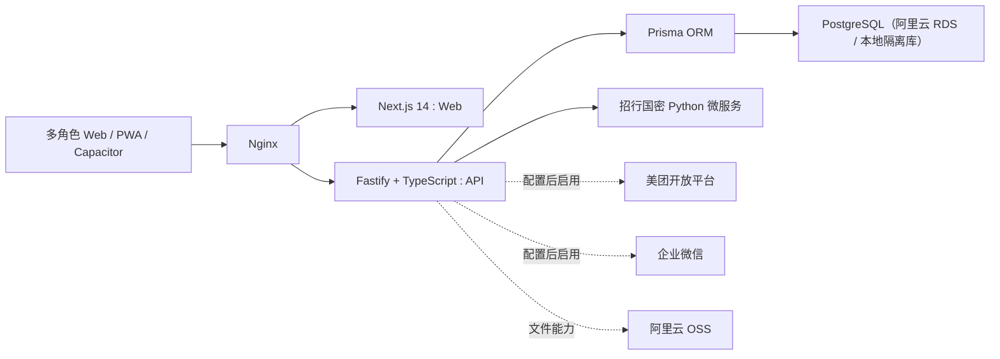

Monorepo：`apps/web`（前端）、`apps/api`（业务 API）、`apps/cmb`（招行国密）、`packages/db`（Prisma）、`scripts`（测试/部署/回滚）。

---

## 7. 边界与未启用项（读代码时需注意）

- **税率口径**：合同税率与含税计算已在 1.3.1/1.3.2 存在，必须保留，不得删除或改口径；不得自行给测试合同指定税率。
- 美团：代码与测试存在，生产未启用，真实数据仍是每日双表上传。
- 招行 CMB：服务在线，但自动付款/同步开关关闭，不得开启。
- 企业微信：配置与代码存在，HTTPS/SSO 端到端未完成验收。
- 月度全量盘点、收货更正/冲销、补送与报损最终口径、负库存策略等仍属业务待确认项。
- 多店/20 店扩展为 P1/P2 目标，当前仅合肥瑶海店为真实试点；严格多租户隔离仍保留。

---

# 核心业务模块拆解与主流程

> 以下状态名、字段名、规则均来自当前代码（HEAD `d75290c`），非文档概述。
> 每条流程按「谁触发 → 经过什么状态 → 产生什么副作用 → 关键规则」组织。

## 流程 A：每日营业导入 → BOM → 预计库存

涉及角色：**店长/厨师长（上传与确认）**、**总厨（补档与回补）**。
入口：`POST /api/daily-business-imports/preview`、`/:id/confirm`、`/bom-tasks/*`、`/bom-recalculation`。

### A1 日报从上传到确认

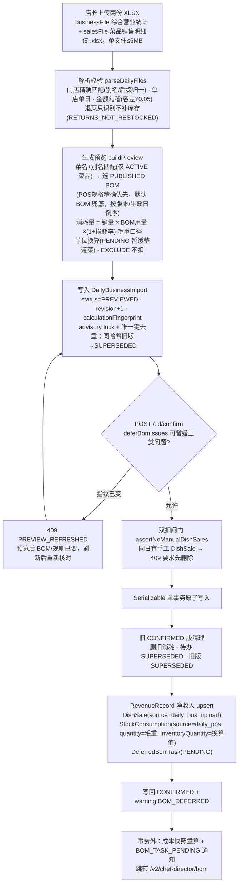

**状态机**：`PREVIEWED → CONFIRMING → CONFIRMED`；更正触发 `CONFIRMED → SUPERSEDED`。
- `PREVIEWED→CONFIRMING` 用 `updateMany(status:PREVIEWED)` 做乐观锁，count≠1 即 409。
- `CONFIRMING` 是事务内瞬时态；整段确认在 `Serializable` 单事务内，失败整体回滚。
- 可暂缓三类：`DISH_UNMATCHED` / `BOM_MISSING` / `INVENTORY_UNIT_PENDING`。
- 时间闸门：北京时间计算，只能导入**已结束营业日**（默认前一天，11:00 截止）。
- 幂等：`GET /:id/confirm` 已 CONFIRMED 直接返回；唯一键 `(storeId,businessDate,业务哈希,销量哈希,fingerprint)` 去重。

**关键业务规则**
- **退菜不补回库存**：退菜只进 `RevenueRecord.rawData.posReturns` 并产生警告，不生成反向消耗。
- **BOM 毛重口径**：`数量 × BOM用量 × (1+损耗率)`，`quantity` 存毛重，`inventoryQuantity` 才是库存/成本准绳。
- **EXCLUDE 策略**：`百家蘸料/纸巾` 等 `Dish.inventoryPolicy=EXCLUDE` 跳过扣减；**赠品是正常销售行按 BOM 扣减**（两条规则不同）。
- **双扣闸门**：同日若存在手工销量则拒绝确认，不静默删除。

### A2 缺菜品/BOM 的回补闭环

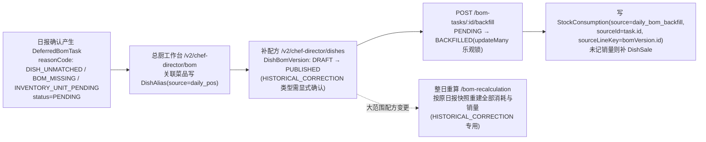

- 幂等三重保护：状态机 `PENDING→BACKFILLED`（count≠1 抛 409）+ 唯一键 `(sourceType,sourceId,sourceLineKey,productId)` + `BACKFILLED` 直接返回。
- `saleRecorded=false`（菜品未匹配）时回补同时补记 `DishSale`；`true` 时只补消耗。
- 单位换算仍为 PENDING 时禁止回补（fail-closed）。
- ⚠️ 易混淆：`consumptionCorrection.ts` 是**单条错误扣减的冲销审计**（保留原行、插入 `correction` 补记），不是日报回补机制。

### A3 门店预计库存滚动

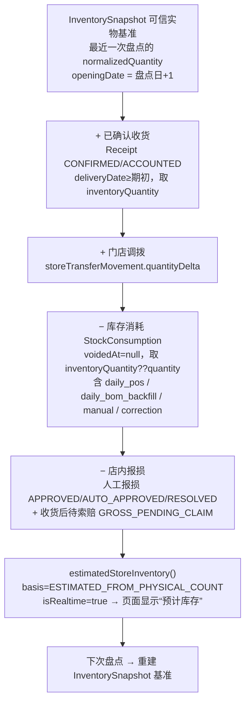

- **同日顺序**：先入库、后按闭店销量扣理论消耗；IN 先于 OUT。
- **供应商库存独立分账**：不用 `Product.minStock`（那是供应商口径），门店用 `StoreInventoryPolicy.minStock/targetStock`；供应商 `Product.stock` 绝不被门店消耗改写。
- `inventoryQuantity` 为空/单位待核验的收货行**排除滚动**并计入 `normalizationPendingCount`（防箱/件当 g/kg）。
- 盘点单 `InventoryCountStatus = DRAFT→COUNTING→REVIEWING→CONFIRMED`，确认后衍生 `InventorySnapshot`；冲销只能对最新基准执行。盘点差异只属门店内部，不产生供应商报损/应付。

---

## 流程 B：上游采购全链路（总仓向外部供应商采购）

入口域：`/v2/supply-chain/procurement`、`/v2/supply-chain/suppliers`，API `routes/upstreamProcurement.ts`。
状态转移由 `domain/upstreamProcurement.ts` 的 `assert*` 转移表强制，非法跳转直接报错。

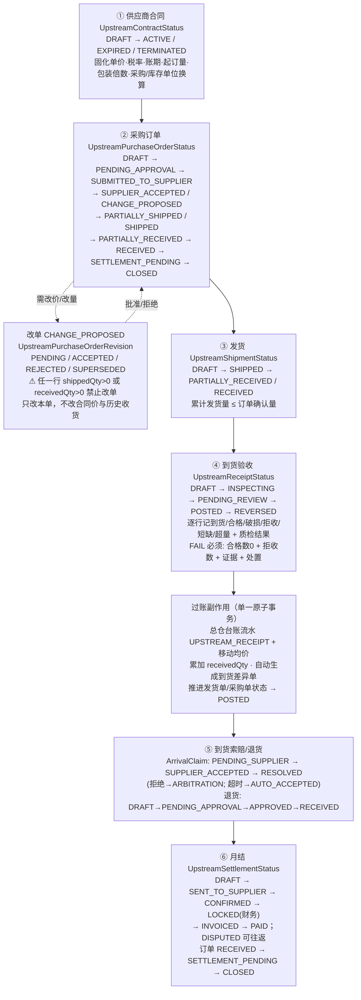

### B1 到货验收的审核与复审闸门

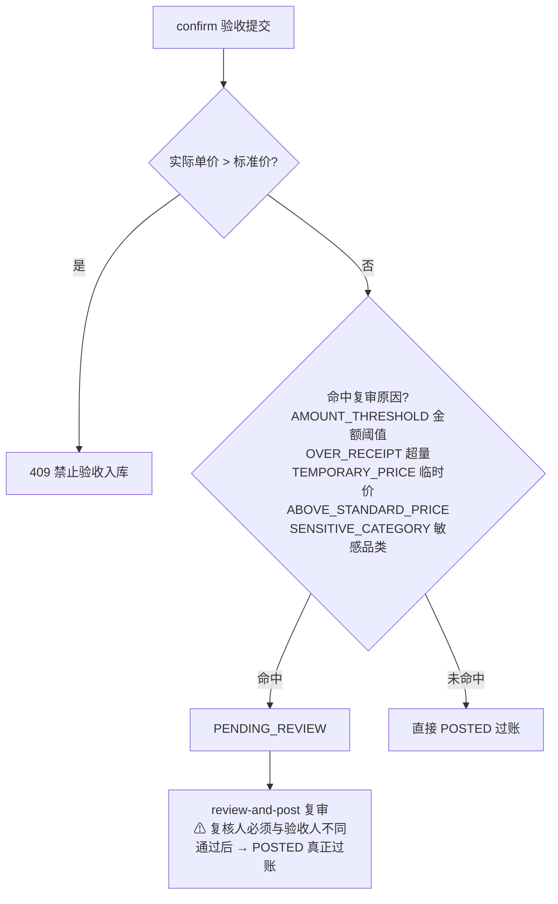

- **改单硬边界**：只要任一行 `shippedQty>0 || receivedQty>0` 就拒绝 409；价格改动标记 `hasTemporaryPrice`。
- **双人复核**：`assertDifferentReceiptReviewer` 防止同一人验收又复审。
- **多图质检**：每行 `qualityEvidence` ≤20 项（jpeg/png/webp/gif/pdf，单张≤10MB），整组质检图 ≤50 张；新模式下按“商品本次进货批次”维护。
- **税率/含税计算**（必须保留）：含税 `lineWithoutTax = 金额/(1+税率)`、`lineTax = 金额 − 不含税额`；不含税 `lineTax = 不含税额×税率`、`lineTotal = 不含税额+税额`；发票要求 `不含税 + 税额 == 价税合计`（±0.01）。

---

## 流程 C：财务闭环（应付 → 对账 → 发票 → 付款 → 凭证）

⚠️ 两个同名“收货”要分清：**① `UpstreamReceipt`（总仓上游采购，流程 B）**；**② `Receipt`（门店/供应商履约收货）**。账期、对账、发票、付款挂在 **②** 上；总仓来源（`sourceType='HEADQ_WAREHOUSE'`）**不生成外部应付**。

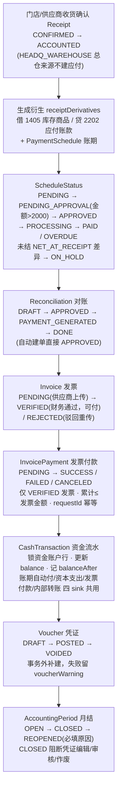

**关键规则**
- **防重付互斥**（`paymentMutex.ts`）：账期路径与发票付款路径二选一——发票已有 `PENDING/SUCCESS` 付款时取消账期（CANCELLED）；发票付款创建时若账期 `PAID/PROCESSING` 则 409，否则批量取消。
- **账期到期规则**（`CreditType`）：`FIXED_DAYS` 到货+N 天、`MONTHLY` 月末+1 月、`WEEKLY` 周结、`ON_DELIVERY` 到货即付。
- **招行 CMB 自动付款默认关闭**（fail-closed）：不满足 `NODE_ENV=production && PREVIEW_MODE!=true && CMB_AUTOPAY_ENABLED=true` 就拒绝调用银行；`test` 租户直接取消，仅保留余额查询等只读能力。
- **月度成本核对（四方）**：`store(createdAt) → chef(confirmedAt) → supplier(supplierVerifiedAt) → finance(financeVerifiedAt)`，四方齐备才入账。
- 其他模块状态：备用金 `REQUESTED→APPROVED→PAID→RECONCILING→CLOSED`；工资 `DRAFT→APPROVED→PAID`；资本支出 `PENDING_APPROVAL→APPROVED→PAID`；付款申请 `PENDING/AUTO_APPROVED/APPROVED/REJECTED/CANCELED`。

---

## 流程 D：库存域（单据复审生效 · 盘点 · 调拨 · 净成本）

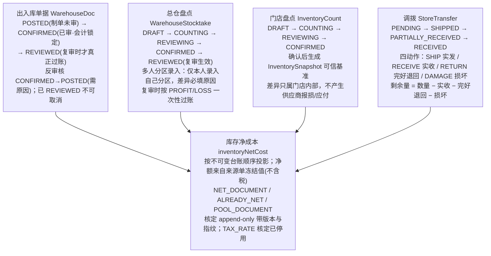

- **复审才生效**：新单据 `postingPolicy='REVIEW'`——制单和审核都不动库存，只有**复审**步骤才调用台账过账并回填 `movementId/postedAt`。
- **库存模式**：`WarehouseInventoryMode = OFF / SHADOW / STRICT`（影子模式补记、严格模式库存不足报错）。
- **调拨成本**：以可信 `InventorySnapshot` 为基准重放流水；SHIP 按调出门店移动均价定价，库存/金额不足则拒绝；`DAMAGE` 的 `quantityDelta/valueDelta` 均为 0，只累加 `damagedQuantity`。
- **净成本边界**：`TAX_RATE` 材料核定方式已停用（改用直接填写成本金额），与“合同税率/发票税额必须保留”是**不同口径**，不要混淆。

---

## 流程 E：订货 → 补货 → 配送 → 收货 → 报损（门店履约主链）

主要角色：**厨师长/店长（下单、收货）**、**供应商（接单、发货、送达）**、**总厨（代下单、仲裁）**、**内部供应链（直接改单、配送调整）**。

### E1 订货单主状态机

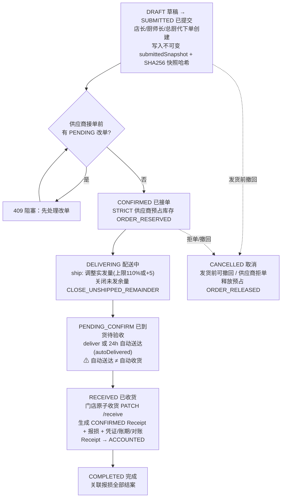

- **单点履约**：首次有效发货即关闭履约余量；存在任一 `SHIPPED/DELIVERED/RECEIVED` 配送单时拒绝再建第二张。未发余量按 `CLOSE_UNSHIPPED_REMAINDER` 关闭并通知，**不补送**。
- **不可变原始单据**：`submittedSnapshot/hash`、`originalQuantity/Price/Amount`、`lineOrigin`、`isActive=false` 软停用 + 事件表 + `opLog`；改单**不覆写**原始行。
- **三层幂等**：请求键（内存+DB 唯一）→ 事件表不可变记录 → `rowVersion` CAS + `Serializable` 事务。
- **预占三段式**：提交 `ORDER_RESERVED` → 接单转交 `TRANSFERRED` → 发货核销 `ORDER_OUTBOUND` / 取消 `ORDER_RELEASED`。STRICT 库存不足整事务回滚，SHADOW 异步补记。
- **暂无自动收货**：24h 只自动送达（`autoDelivered:true` 解锁状态），收货事实永远来自门店人工 `PATCH /receive`；自动送达单的 `deliveryDate` 回退到 `expectedDate`。

### E2 改单（Revision）双通道

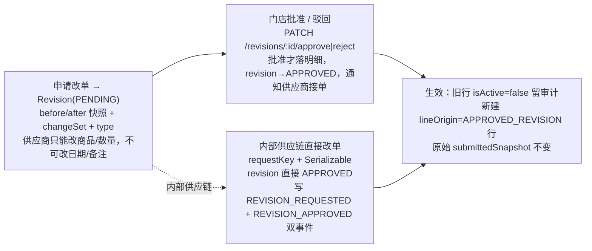

- 接单前必须先处理完所有 `PENDING` 改单；一单只允许一个 `PENDING` 改单。
- 旧入口 `/add-items` 已封口（409）：接单后不能直接改原始订货单。

### E3 独立补货单与预占转交

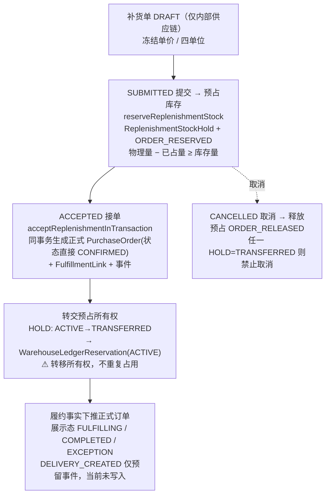

- 提交预占重复请求返回 409（不静默重建）；目录变价返回 `REPLENISHMENT_PRICE_CHANGED` 要求回草稿确认。
- 并发接单只有一单成功，其余凭 `FulfillmentLink` 唯一键 replay 返回同一结果。

### E4 收货与财务派生

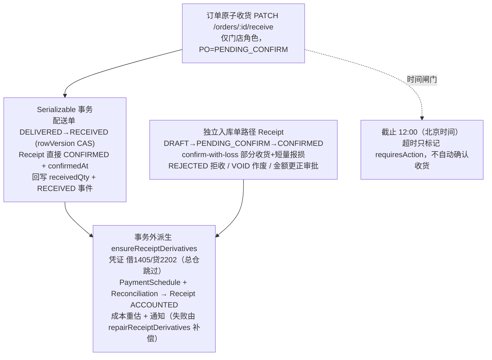

- `Receipt.totalAmount = Σ(receivedQty × unitPriceSnapshot)`，不用 PO 总额；`deliveryOrderId` 唯一约束兜底重复收货。
- 短量/破损按 **kind 分组**建报损单（按 reason 分组会影响两位小数舍入边界）；`payableBasis='NET_AT_RECEIPT'`。

### E5 报损/到货差异闭环

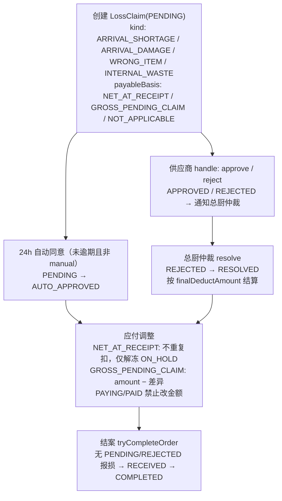

- **应付基准二选一**：验收净额（`NET_AT_RECEIPT`）确认差异不再扣款；事后补报（`GROSS_PENDING_CLAIM`）确认后才从全额中扣。
- 任何未决差异 → `PaymentSchedule.status='ON_HOLD'`；逾期补报必须人工审批，不走 24h 自动同意。
- 店内报损 `<¥500 → AUTO_APPROVED`，`≥¥500 → PENDING`（`≥¥3000` 通知老板）；`INTERNAL_WASTE` 不进供应商应付。
- `ARRIVAL_SHORTAGE` 结案按行冲回 `ORDER_OUTBOUND`；`ARRIVAL_DAMAGE` 不自动冲回。

---

## 五大主流程总览

| 流程 | 触发角色 | 核心状态链 | 关键产出 | 安全/不变量 |
|---|---|---|---|---|
| A 日报→BOM→库存 | 店长 / 总厨 | PREVIEWED→CONFIRMING→CONFIRMED→SUPERSEDED | 营业/销量/消耗、DeferredBomTask、预计库存 | 单事务原子、指纹刷新、幂等回补 |
| B 上游采购 | 供应链 / 供应商 / 财务 | 合同→订单(MULTI)→发货→验收(复审)→索赔→月结 | 总仓台账流水、差异单、结算单 | 转移表强校验、高于标准价禁入、双人复核 |
| C 财务闭环 | 财务 / 系统 | PaymentSchedule→Reconciliation→Invoice→Payment→Voucher | 账期、对账单、付款、资金流水、凭证 | 防重付互斥、CMB默认关、月结锁账 |
| D 库存域 | 供应链 / 店长 | 单据 POSTED→CONFIRMED→REVIEWED；盘点/调拨 | 台账流水、盘点基准、调拨双账 | 复审才过账、快照基准、净成本冻结 |
| E 门店履约 | 厨师长/店长 / 供应商 / 总厨 | SUBMITTED→CONFIRMED→DELIVERING→PENDING_CONFIRM→RECEIVED→COMPLETED | 配送单、收货单、报损、账期 | 不可变快照、预占转交、无自动收货 |

**一句话总链路**：

> 门店下单（预占）→ 供应商接单（转交预占）→ 发货（关余量）→ 送达（仅解锁）→ 门店人工收货（生成 Receipt + 短量报损 + 凭证/账期/对账，入库应付按实收净额）→ 报损结案（24h 自动同意或总厨仲裁，冻结账期解冻）→ 订单 COMPLETED → 财务按账期付款 → 凭证与月结。日报每日把销量按 BOM 扣成食材消耗，在盘点基准上滚动出“预计库存”；总仓采购则走合同、订单、验收复审、月结的独立闭环。
