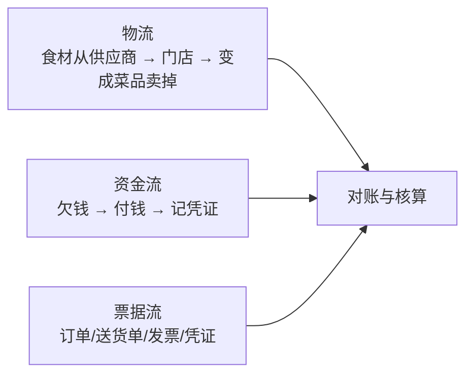
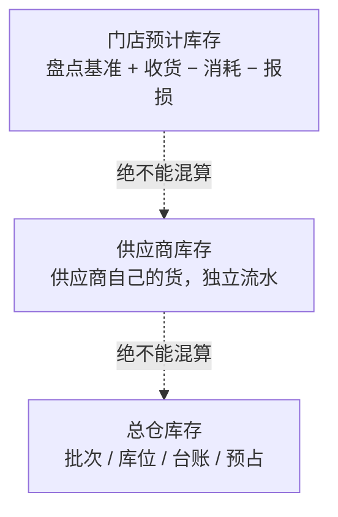
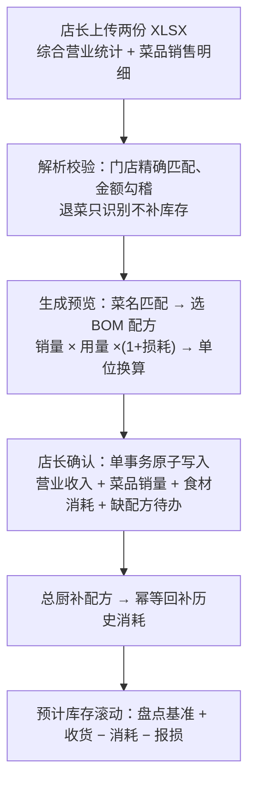
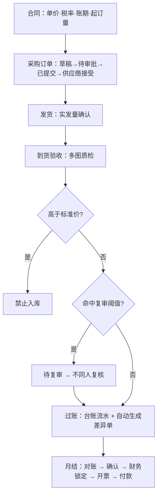
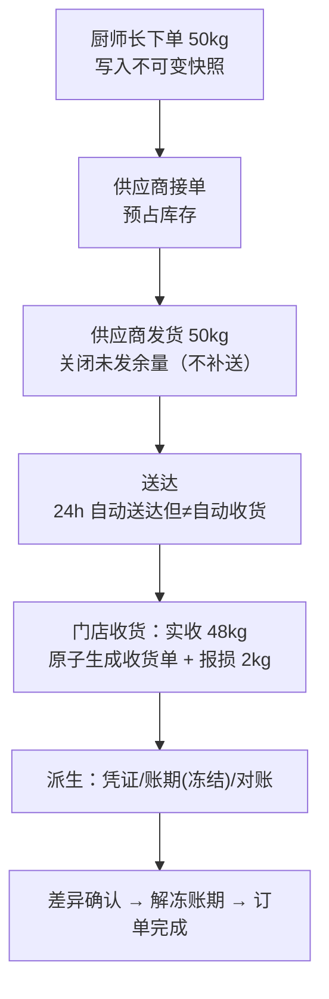

# 滇界云管 · 产品经理速成手册

> 目标读者：新接手滇界 V4 的产品经理、需求方、业务方。
> 目标：不是让你背下几百条规则，而是**建立判断力**——看到一个需求，知道它动了哪块业务、会影响谁、什么能自己定、什么必须找业务方拍板。
> 写法约定：先讲**餐馆里发生了什么**，再讲**系统怎么对应**，最后讲**你要注意什么**。

---

## 目录

0. [这本手册怎么用](#0-这本手册怎么用)
1. [先懂生意：一家餐馆每天在忙什么](#1-先懂生意一家餐馆每天在忙什么)
2. [餐饮行业常识](#2-餐饮行业常识)
3. [库存管理常识](#3-库存管理常识)
4. [供应链与门店常识](#4-供应链与门店常识)
5. [财务常识](#5-财务常识)
6. [五大主流程（业务视角）](#6-五大主流程业务视角)
7. [真实案例串讲：到货少了 2kg](#7-真实案例串讲到货少了-2kg)
8. [产品经理的工作边界与决策清单](#8-产品经理的工作边界与决策清单)
9. [如何快速建立体感](#9-如何快速建立体感)
10. [术语速查表](#10-术语速查表)

---

## 0. 这本手册怎么用

### 「懂」分四层，别混为一谈

| 层级 | 表现 | 达成方式 | 大致时间 |
|---|---|---|---|
| L1 能复述流程 | 知道收货后会派生账期、对账、凭证 | 读这本手册 | 3~5 天 |
| L2 独立负责一块 | 能独立处理"日报导入"的需求 | 接一个小需求做一遍 | 2~3 周 |
| L3 判断跨模块影响 | 有人要改报损金额算法，你立刻知道会连带影响应付、账期、凭证、对账四处 | 踩坑 + 复盘 | 1.5~2 个月 |
| L4 拍板业务口径 | 能回答"什么情况该冻结账期""用哪种应付口径" | 真实案例喂出来 | 2~3 个月 |

**体感 = L2 到 L3 之间。** 它是被问题逼出来的，不是被文档灌出来的。

### 三条学习方法

1. **先跟一笔真实单据走完全流程**（本手册第 7 节就是范例），不要从功能列表开始背。
2. **读代码里的 `enum` 和状态转移表**——那是业务规则的硬化形态，比任何文档都准。文档可能滞后（例：文档说"一订货单可多次配送"，代码实际是"首次发货即关闭履约"）。
3. **记「口径清单」**——每遇到一个"为什么这么算"，记下来，三个月后你就有了一份别人没有的资产。

> ⚠️ 目标是**可靠判断力**，不是记住全部规则。这套系统有些业务口径至今未定（补送与报损、入库更正、负库存策略），业务方自己也在讨论。

---

## 1. 先懂生意：一家餐馆每天在忙什么

### 一句话本质

> **用食材换钱，赚的是差价；难的是食材会变质、数量不标准、而且一堆人参与其中。**

任何餐饮连锁每天都在回答两个问题：

1. **卖了多少？**（营收）—— 来自收银 / POS
2. **花了多少？**（成本）—— 主要是食材成本，占营业额的 **30~40%**

两者相减就是利润。系统里所有复杂机制，本质上都是为了让这两个数字**算得准、对得上、能追溯**。

### 三流并行



货和钱的速度不一样：货今天到，钱可能 30 天后付，发票可能更晚。**复杂度全在这三条流的"缝"上**——派生、对账、冻结。

### 角色地图（谁在跟谁打交道）

| 角色 | 在餐馆里干什么 | 在这套系统里关心什么 |
|---|---|---|
| 厨师长 / 店长 | 看库存、下单、收货、报损、上传日报 | 预计库存够不够、货到得对不对 |
| 总厨 | 管菜品配方、处理缺料、仲裁报损争议 | BOM 齐不齐、成本准不准 |
| 供应商 | 接单、送货、开发票 | 订单改没改、什么时候付款 |
| 内部供应链 | 管总仓采购、配送、商品主数据 | 合同价、验收、月结 |
| 财务 | 对账、审发票、付款、记账 | 应付金额、账期、凭证 |
| 老板 | 看报表、审批大额支出 | 门店利润、成本率 |

---

## 2. 餐饮行业常识

### 2.1 菜品与 BOM——餐饮成本核算的"魔法"

- **菜品**：售卖单元，比如"宫保鸡丁 38 元"。
- **BOM（配方）**：这道菜需要什么料、各多少——鸡腿肉 300g、花生 50g、调料 15g。
- **毛重口径**：采购来的鸡带骨头，BOM 按毛重算，实际用量要 `× (1 + 损耗率)`，比如 10% 损耗 → 330g。
- **倒推消耗**：这是餐饮最核心的魔法——**不用每天称原料，只要知道卖了多少份菜，就能算出用了多少食材**。

> 产品经理要记住：**配方没建、单位没换算，库存就是错的**。所以系统里有 `BOM_MISSING`（缺配方）、`INVENTORY_UNIT_PENDING`（单位待核验）这类阻断项，而且缺了就不能整份日报确认。

### 2.2 日报——连接"卖"和"算消耗"的桥梁

每天打烊后，收银系统导出两张表：**综合营业统计**（营业额、优惠、净收入）+ **菜品销售明细**（每道菜卖了几份）。店长上传后系统做三件事：

1. 记**营业收入**（用**净收入**而非营业额，因为打折、退菜）
2. 记**菜品销量**
3. 按 BOM **扣减食材库存**

**餐饮铁律**：
- **退菜不补回库存**——菜已经做出来了，料已经用了。
- **赠品按 BOM 扣减**——它是正常销售行（显式收入为 0），除非标记为 `EXCLUDE`。
- **百家蘸料、纸巾**这类不扣库存——`Dish.inventoryPolicy = EXCLUDE`。

> 补充：在真正的美团到店 SaaS 里，这个数据是 POS 通过 API 自动同步的。本系统用"手工上传双表"，是 **POS 集成尚未打通时的临时替代方案**——所以代码里有 `MEITUAN_ENABLED` 开关但生产没开。

### 2.3 食材成本率（Food Cost %）

> 食材成本 ÷ 营业额，餐饮最核心的指标。健康区间通常 **30~40%**。

太高说明浪费/损耗/定价有问题，太低可能偷工减料。老板和财务的报表里到处是这个指标。

---

## 3. 库存管理常识

### 3.1 为什么叫「预计库存」

餐馆不可能实时称重，所以库存是**算出来的**：

```text
预计库存 = 上次盘点基准
         + 后续已确认收货
         − BOM / 人工 / 日报消耗
         − 店内报损
```

- **盘点**：定期实物清点一次，重立可信基准（系统里叫 `InventorySnapshot`）。
- 下次盘点时，会**重建基准**，之前的误差一次性归零。
- 页面和接口必须带"预计"二字——它不是实时称重的物理库存。

### 3.2 三本账必须分开



- 门店消耗**绝不能改**供应商 `Product.stock`——这是两本账。
- 门店安全库存用 `StoreInventoryPolicy`，**不能复用** `Product.minStock`（那是供应商口径）。
- 供应商库存、门店库存、总仓库存混算，账就全错了。

### 3.3 单位换算（采购单位 / 库存单位 / 起订单位）

同一件商品可能有多个单位：采购按"箱"、库存按"kg"、下单必须整箱起订。系统要求逐个维护换算关系。

> 产品经理要记住：**单位没换算或换算状态是 PENDING，相关行会被排除在库存滚动之外**，否则会把"箱"当"kg"用。

### 3.4 移动加权平均成本

不同批次进价不同，库存金额按加权平均算，不是简单相加。每次收货都会刷新平均成本——这就是为什么"收货后要重估消耗成本"。

---

## 4. 供应链与门店常识

### 4.1 订货 → 配送 → 收货——餐饮供应链最特色的地方

**订购量 / 实发量 / 实收量，三个数字永远并列显示。** 这是餐饮供应链和其他行业最大的不同：

- 你订 50kg 鸡肉，供应商可能只有 48kg，或送来 52kg；
- 供应商发货前可以调"实发量"，门店收货时再确认"实收量"；
- 三者差额就是**到货差异**（短缺、破损、错发），要走报损/索赔。

### 4.2 几个反直觉但正确的规则

| 规则 | 为什么 |
|---|---|
| 原始订单不可覆盖 | 订单是合同凭据。供应商可"申请改单"，但**必须门店批准**；系统保留不可变快照防赖账 |
| 发货时调减不算报损 | "应到量"以 `shippedQty` 为准。供应商在发货环节协商调减，是正常履约 |
| 到货后少 2kg 才算报损 | 实收 < 应到，才是真正的短缺 |
| 自动送达 ≠ 自动收货 | 24h 只解锁状态，收货事实必须门店人工确认，防止"货没到→自动收货→幽灵入账" |
| 首次发货即关闭履约 | 未发余量直接关闭并通知"不补送"；需要更多货要重新下单 |
| 短量报损按 kind 分组 | 按"原因"分组会影响两位小数舍入边界，导致应付金额取决于操作员措辞 |

### 4.3 到货差异的几种类型

- **短缺**（`ARRIVAL_SHORTAGE`）：送少了
- **破损**（`ARRIVAL_DAMAGE`）：坏了、品质异常
- **错发**（`WRONG_ITEM`）：送错 SKU
- **店内报损**（`INTERNAL_WASTE`）：门店自己的损耗，不追责供应商

供应商可以接受、拒绝；拒绝后由**总厨仲裁**。逾期 24h 不处理会自动同意（但**逾期补报必须人工审批**）。

### 4.4 供应商直送门店 vs 总仓采购

| 模式 | 说明 | 财务后果 |
|---|---|---|
| 供应商直送门店 | 货物直接到店，当前主要模式 | 产生对供应商的应付、账期、发票 |
| 总仓采购（`HEADQ_WAREHOUSE`） | 总仓向外部供应商采购 | **不建外部应付凭证和账期**，只留收货记录 |

> 这条特别重要：产品经理看到"总仓收货没生成账期"不要以为是 bug，是设计如此。

### 4.5 元 / 角 / 分的小数问题

金额用 `Decimal` 类型，禁止浮点累加。两条小数规则要记住：

- 金额显示**两位小数**
- 日期默认按**北京时间**处理

---

## 5. 财务常识

### 5.1 从收货到付款的完整链条

```text
收货 → 账期 → 对账 → 发票 → 付款 → 资金流水 → 凭证
```

| 概念 | 大白话 |
|---|---|
| 账期 | 供应商赊账，比如"到货后 30 天付款" |
| 应付账款 | 欠供应商的钱，收货时就产生了 |
| 对账 | 月底供应商和财务核对"我到底该付你多少" |
| 发票 | 供应商开票，财务审核通过才能付款（税务合规） |
| 付款 | 钱真正付出去，记银行流水 |
| 凭证 | 会计分录，记"钱从哪来到哪去" |

### 5.2 复式记账（借 / 贷）

每笔钱都有**借方和贷方，两边相等**。收货时的经典分录：

```text
借：库存商品   1,056 元
    贷：应付账款   1,056 元
```

付款时：

```text
借：应付账款   1,056 元
    贷：银行存款   1,056 元
```

这就是凭证。财务的严谨性来自这里——每一分钱都能追到来源和去向。

### 5.3 含税 / 不含税（税务口径，绝对不能删）

同一笔金额，按含税还是不含税算，结果差很多。合同上会写 `taxInclusive`（是否含税）和 `taxRate`（税率）：

- 含税：`不含税额 = 金额 ÷ (1 + 税率)`，`税额 = 金额 − 不含税额`
- 不含税：`税额 = 不含税额 × 税率`，`总额 = 不含税额 + 税额`

> ⚠️ 用户明确决定：**税率与含税计算必须保留，不得删除或改口径，也不得自行给测试合同指定税率。** 这是合规红线。

### 5.4 应付口径的两种玩法（最容易出错的地方）

| | NET_AT_RECEIPT（验收净额） | GROSS_PENDING_CLAIM（全额待索赔） |
|---|---|---|
| 收货时应付 | 按**实收**金额（1,056） | 按**订购全额**挂账（1,100） |
| 差异确认后 | **不重复扣**，只解冻账期 | **扣差额 44 元** → 1,056 |
| 场景 | 验收时就有差异 | 验收后事后补报 |

两种最终都付 1,056，但**记账时机不同**。选错口径就会重复扣钱或多付钱。

### 5.5 账期冻结（ON_HOLD）

任何未结案的到货差异，都会把 `PaymentSchedule` 置为 `ON_HOLD`——**争议没结案，先别付钱**。差异解决后才解冻。

另外：金额 > 2000 元的账期需要老板审批（`AUTO_PAY_THRESHOLD = 2000`）。招行 CMB 自动付款默认关闭，必须显式开开关才走真实银行。

### 5.6 其他财务模块速览

| 模块 | 流程 |
|---|---|
| 月度成本核对 | 门店 → 厨师长 → 供应商 → 财务，四方都确认才入账 |
| 备用金 | 申请 → 审批 → 发放 → 报账 → 关账 |
| 工资 | Excel 上传 → 审批 → 发放（自动记凭证） |
| 资本支出 | 店长申请 → 老板批 → 财务付（新店筹建、大型装修） |
| 月结锁账 | 关账后凭证不能再改；重开必须填原因 |

---

## 6. 五大主流程（业务视角）

### 总览

| 流程 | 谁触发 | 核心状态链 | 关键产出 |
|---|---|---|---|
| A 日报→BOM→库存 | 店长 / 总厨 | 预览→确认→完成 | 营业/销量/消耗、缺配方待办、预计库存 |
| B 上游采购 | 供应链 / 供应商 / 财务 | 合同→订单→发货→验收复审→索赔→月结 | 总仓台账、差异单、结算单 |
| C 财务闭环 | 财务 / 系统 | 账期→对账→发票→付款→凭证 | 账期、资金流水、凭证 |
| D 库存域 | 供应链 / 店长 | 制单→审核→复审才过账 | 台账流水、盘点基准、调拨 |
| E 门店履约 | 厨师长/店长/供应商/总厨 | 已提交→已接单→配送中→待验收→已收货→完成 | 配送单、收货单、报损、账期 |

### 流程 A：日报 → BOM → 预计库存



**PM 注意**：
- 确认前如果 BOM/配方变了，系统会返回 `PREVIEW_REFRESHED`，要求重新核对——这是防止用旧规则算错账。
- 缺配方不阻塞整份日报，可以"暂缓并确认"，转给总厨后续补。

### 流程 B：上游采购（总仓向外部供应商采购）



**PM 注意**：
- 实际单价 > 标准价 → **直接禁止验收入库**（硬规则）。
- 金额超阈值、超量收货、临时价、敏感品类 → 必须**不同人复审**才能生效。
- 改单硬边界：只要任一行已发货或已收货，就**禁止改单**。

### 流程 C：财务闭环

见第 5 节。核心记住：**防重付**——账期自动付款和发票付款两条路径互斥，不能重复付。

### 流程 D：库存域

核心规则：**制单和审核都不动库存，只有「复审」才真正过账**。盘点、调拨也一样——审核后还要复审才生效。这是为了防止错误单据直接改账。

### 流程 E：门店履约



---

## 7. 真实案例串讲：到货少了 2kg

> 这是建立体感最快的一个场景。建议拿它当新人培训的第一课。

### 场景设定

| 项目 | 值 |
|---|---|
| 门店 | 合肥瑶海店 |
| 食材 | 鸡腿肉 |
| 订购量 | 50 kg，单价 22 元/kg |
| 实发量 | 供应商发货确认 50 kg |
| **实收量** | **门店验收只有 48 kg** |
| 账期 | 到货后 30 天 |

### 全程走一遍

| 站点 | 业务发生了什么 | 系统状态 / 产出 | 关键规则 |
|---|---|---|---|
| 1 下单 | 厨师长订 50kg | `SUBMITTED` + 不可变快照 | 从这一刻起"订了 50kg"钉死 |
| 2 接单 | 供应商承诺供货 | `CONFIRMED` + 预占库存 | 动的是供应商库存账，不是门店账 |
| 3 发货 | 供应商发 50kg | `DELIVERING` + 关闭余量 | 发货时调减不算报损；首次发货即关闭履约 |
| 4 送达 | 货到了 | `PENDING_CONFIRM` | **只解锁，不自动收货** |
| 5 收货 | 实收 48kg | `Receipt CONFIRMED` + 报损 2kg | 应付按**实收**算：48×22=1,056 元 |
| 6 派生 | 收货后自动生成 | 凭证（借库存/贷应付 1,056）+ 账期 `ON_HOLD` + 对账单 | 争议没结案，先别付钱 |
| 7 差异 | 供应商确认少 2kg | 报损 `APPROVED` + 解冻账期 + 订单 `COMPLETED` | `NET_AT_RECEIPT` 不重复扣款，只解冻 |
| 8 付款 | 30 天后财务付款 | 对账 → 审发票 → 付款 → 资金流水 → 凭证 | 防重付互斥；CMB 默认关闭 |

### 这个案例教会你什么

| 机制 | 防的风险 |
|---|---|
| 不可变快照 + 哈希 | 事后赖账 |
| 预占 / 转交 / 核销 | 超卖、重复占用 |
| 三量并列 | 生鲜短交扯皮 |
| 原子收货 + 唯一约束 | 重复收货、幽灵入账 |
| 账期冻结 | 争议未结就付错钱 |
| 两种应付口径 | 重复扣款 / 少扣款 |
| 凭证 + 复式记账 | 账实不符 |

**一句话**：系统不是在"记录数据"，而是在**替餐馆和供应商，把每一笔可能扯皮的交易，变成所有人都认账、出问题能倒查的原始凭证**。

---

## 8. 产品经理的工作边界与决策清单

### 8.1 遇到需求先问：这是「系统机制」还是「业务口径」？

| 类型 | 谁拍板 | 例子 |
|---|---|---|
| 系统机制 | PM 可以定，看技术/体验 | 页面加搜索、列表分页、按钮文案 |
| 业务口径 | **必须找业务方拍板** | 应付按实收还是全额、什么情况冻结账期、税率口径 |

> PM 最大的价值不是画图，而是**把业务口径问清楚、写明白**。口径错了，功能做得再漂亮也是错的。

### 8.2 口径红线清单（不能碰）

1. **税率与含税计算**必须保留，不得删除或改口径。
2. 原始订货单的**订购量、单价不可无痕覆盖**。
3. 供应商库存与门店库存**分账**，不能混算。
4. 门店库存必须显示"**预计**"二字，不冒充实时实物库存。
5. 退菜**不补库存**；EXCLUDE 菜品**不扣库存**。
6. 总仓来源收货**不建外部应付**。

### 8.3 尚待业务确认的事项（别自作主张）

| 事项 | 当前临时规则 | PM 能做什么 |
|---|---|---|
| 已确认入库更正 | 尚未定稿 | 不覆盖原记录，先做方案和测试 |
| 补送与报损关系 | 补送要计成本和库存，不设免费补送 | 等业务确认状态机后再实现 |
| 负库存 | 默认不应静默允许 | 先告警/阻止 |
| 月度全量盘点 | 暂缓 | 不作为前置阻塞 |
| 菜品替代料优先级 | 鲜鸡/冻品可替代，其他逐项确认 | 禁止模糊匹配批量替代 |

### 8.4 文档与代码不一致的地方（以代码为准）

| 说法 | 实际 |
|---|---|
| "一订货单可多次配送" | 代码是首次有效发货即关闭履约，拒绝第二张配送单 |
| `DELIVERY_CREATED` 事件 | 枚举存在但当前路由未写入，仅预留 |
| "日报回补靠 `consumptionCorrection`" | 那是单条错误扣减的冲销审计；日报回补在 `/bom-tasks/:id/backfill` |
| 两个 `Receipt` | 总仓 `UpstreamReceipt` 与门店 `Receipt` 是两套，账期挂门店这套 |

---

## 9. 如何快速建立体感

### 9.1 6~8 周上手路径

| 阶段 | 做什么 | 时间 |
|---|---|---|
| 第 1 周 | 跟着一笔真实订单走完全流程（第 7 节），自己画一遍时序图 | 3~5 天 |
| 第 2 周 | **不看文档**，凭记忆默画五大流程状态机，画不出来的就是盲区 | 3~5 天 |
| 第 3~4 周 | 接一个真实小需求，从写 PRD 到看它上线 | 2 周 |
| 第 2 个月 | 接一个跨模块需求，体会"改这里会炸那里"，开始记口径清单 | 4 周 |
| 第 3 个月 | 主持一次业务口径讨论，能分辨技术问题 vs 业务决策 | — |

### 9.2 自测 5 题（答得上来就有体感了）

1. 为什么 24h 自动送达后不自动收货？
2. 报损确认后应付金额变不变？（要答出分两种口径）
3. 为什么供应商改单必须门店批准？
4. 一张收货单派生了什么？哪个派生失败**不会**让收货回滚？
5. 税率字段能不能删？为什么？

<details>
<summary>参考答案（先自己想，再看）</summary>

1. 防止"货没到→自动送达→自动收货→幽灵入账"，收货事实必须门店人工确认。
2. `NET_AT_RECEIPT` 不变（只解冻账期）；`GROSS_PENDING_CLAIM` 要扣差额。
3. 订单是合同凭据，防止供应商单方面改账；原始数量/单价不可无痕覆盖。
4. 派生凭证、账期、对账单；凭证在事务外补建，失败只留警告，不回滚收货。
5. 不能删——税率与含税计算是 1.3.1/1.3.2 已有口径，属合规红线，用户已明确决定必须保留。

</details>

### 9.3 读代码的技巧

别从 6000 行 schema 开始。按这个顺序：

1. 先看 `packages/db/prisma/schema.prisma` 里的 **`enum`**（业务规则的硬化形态）
2. 再看 `apps/api/src/domain/*` 里的 **`assert*Transition`**（状态转移表）
3. 最后才看 `apps/api/src/routes/*` 的具体实现

配套文档：`docs/PRODUCT_FUNCTION_ARCHITECTURE.md`（含 15 张按真实代码绘制的流程图）。

---

## 10. 术语速查表

| 术语 | 大白话 |
|---|---|
| BOM / 配方 | 一道菜需要哪些料、各多少 |
| 毛重 / 净重 | 带骨带皮的重量 / 能吃的净料重量 |
| 损耗率 | 加工过程的浪费比例 |
| 倒推消耗 | 从销量 × 配方反推用了多少食材 |
| EXCLUDE | 不扣库存（纸巾、蘸料等） |
| 预计库存 | 不是称出来的，是"盘点 + 流水"算出来的 |
| 盘点基准 / `InventorySnapshot` | 实物清点后重立的可信起点 |
| 安全库存 / 目标库存 | 不能低于的量，低了就订货 |
| 移动加权平均 | 不同进价的货混在一起时的成本算法 |
| 实发量 / 实收量 | 供应商发出 / 门店实际收到的数量 |
| 到货差异 | 送少了、坏了、发错了 |
| 报损 / 索赔 | 差异的责任认定和金额处理 |
| 账期 | 先拿货后付钱的天数 |
| `ON_HOLD` | 账期冻结，争议未结不付钱 |
| `NET_AT_RECEIPT` | 应付按实收净额，差异不重复扣 |
| `GROSS_PENDING_CLAIM` | 应付按全额挂账，差异确认后才扣 |
| 应付账款 | 欠供应商的钱 |
| 对账 | 月底核对"该付多少" |
| 发票 | 供应商开的税务凭证，审核通过才能付款 |
| 凭证 / 复式记账 | 会计分录，有借有贷、两边相等 |
| 含税 / 不含税 | 金额是否包含增值税，口径不同结果不同 |
| 食材成本率 | 食材成本 ÷ 营业额，餐饮核心指标（30~40%） |
| 月结 / 锁账 | 一个月结束后封账，不再改 |

---

> **最后一句**：PM 的核心能力不是记住这套系统的所有状态，而是——看到一个需求，能迅速判断它动的是物流、资金流还是票据流，会影响哪些角色，以及哪些口径必须找业务方确认。做到这一点，你就已经超过 80% 的人了。
